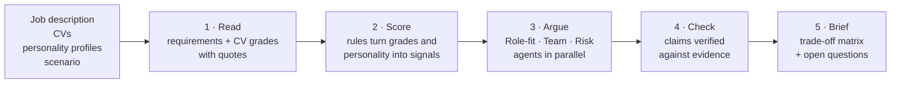

# Meridian

Decision support for C-suite hiring. Meridian compares candidates for a role under a chosen business scenario. It shows the trade-offs between them, with every argument linked to its evidence.

> This repository contains the **backend** of the project

## 1. The problem

**Hackathon track:** BMW Digital Excellence Hub Hackathon 2026, GenAI & Multi-Agent.

See the [full track description (PDF)](docs/track/bmw-decision-intelligence-track.pdf).

**What we know about each hire**

- **The role:** a job description.
- **The candidates:** a CV for each, and optionally a personality assessment (Big Five scores).
- **The current leadership team:** the personality profiles of the people the new hire will work with.
- **The business situation:** for example a turnaround, an acquisition or a growth phase.

**How HR would do it**

1. Turn the job description into a list of requirements and decide which ones matter most in the current situation.
2. Go through each CV requirement by requirement, noting the evidence for it, what's only partly there and what's missing.
3. Read the personality results for risks, such as how the person handles stress, and for how they'd fit with the existing team.
4. Discuss each candidate from different angles (capability, team fit, risk), and write down open questions for the interviews.
5. The committee weighs the trade-offs and decides.

This process is rigorous, and it takes a lot of time.

## 2. The approach

Meridian's goal is to give this process a **warm start**. It prepares suggestions, plus scores for key signals, and each one refers back to the evidence in the documents. This way the reviewers start from a draft they can check against the CVs, rather than from a blank page, and the decision stays with them.

Technically, LLMs read the documents and draft the arguments, rules compute the scores, and a final check removes any claim its evidence doesn't support.

## 3. The pipeline



1. **Read (LLM).** The job description is turned into a list of requirements, each with a priority for each scenario. Each CV is graded against every requirement (exceeds, meets, partial or gap). A positive grade must quote the CV. A gap must come with a question to ask in the interview.
2. **Score (rules).** The grades and the Big Five personality scores become typed signals, using thresholds that depend on the scenario. An example is "strong track record in transformation, but high stress reactivity". The candidate's profile is also compared with the current leadership team.
3. **Argue (LLM agents).** Three agents look at the same candidates, each through its own lens and with only its own slice of the signals. **Role fit** looks at capability. **Team dynamics** looks at how the candidate fits the existing team. **Risk** looks at what could go wrong. Each claim an agent makes must reference a signal, a CV grade or a CV quote.
4. **Check (rules).** Every claim is checked against the source. Claims are removed if the quote isn't in the CV, the cited grade says something else, or the referenced signal doesn't exist. Where agents disagree, or where the CV and the personality profile point in opposite directions, the disagreement is kept and marked as contested.
5. **Brief.** The output is a trade-off matrix (requirements × candidates, each cell with its CV evidence). With it come the contested points and the open interview questions, plus a short summary. Meridian doesn't pick a winner.

**Changing the scenario** re-weights the requirements and signals and runs steps 2–5 again. The CV grading is reused, so the committee can ask "what if this is really a turnaround?" and see the answer in seconds.

## 4. Limitations and next steps

- **No interaction.** Reviewers can't correct the output or add new criteria. The brief is produced once and can't be adjusted.
- **Hand-made scoring rules.** The thresholds were set by hand and checked only on a few synthetic examples.
- **No evaluation.** The output quality hasn't been measured against expert judgments or real hiring outcomes.

### Next steps

- Let reviewers edit requirements and grades and add their own criteria, then re-run only the affected steps.
- Calibrate the scoring rules on real, anonymised cases.
- Evaluate the briefs against HR experts' assessments, and measure how stable the LLM's grades are across repeated runs.

## Running the backend

Requires Python 3.12+ and [uv](https://docs.astral.sh/uv/).

1. **Credentials.** Copy `.env.example` to `.env` and set one API key (Anthropic, OpenRouter or DeepSeek).
2. **Start the API.**
   ```bash
   uv sync
   uv run --env-file .env uvicorn meridian.api.app:app --port 8000
   ```
3. **Send the data.** Post the job description, the candidates' CVs (and optional Big Five scores) and the scenario to `POST /api/evaluate`. You can try the requests from the docs page at `http://localhost:8000/docs`. Synthetic sample cases are in `tests/fixtures/scenarios/`.
